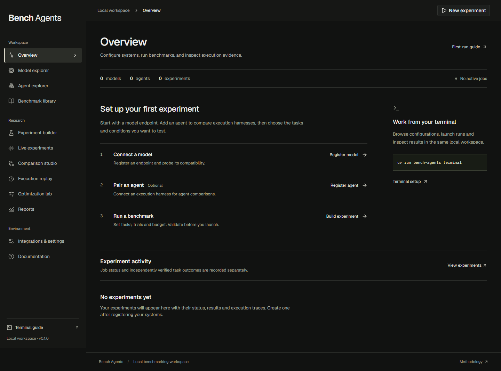
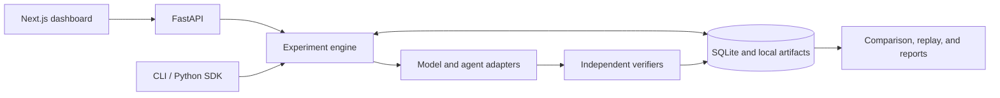

# Bench Agents

Run local experiments on AI models and agent harnesses, verify their outputs, and inspect the evidence behind each result.

Bench Agents combines a browser dashboard, command-line interface, REST API, and Python SDK over the same SQLite workspace. Compare configured systems, investigate failures, test configuration changes, and export results without a hosted Bench Agents account.

**Status: 0.1.0 development.** The offline workflow and local HTTP integration tests pass. Real-model generation, Docker execution, and credentialed native-agent runs still have verification gates. See [verification status](#verification-status).

[Get started](#get-started) · [Testing walkthrough](docs/testing.md) · [Model endpoints](#configure-a-model-endpoint) · [Agent harnesses](#evaluate-an-agent-harness) · [Development](#develop-and-test)



Fresh workspaces contain no models, agents or results. Register your own systems when ready. The [comparison](docs/evidence/comparison-desktop.png) and [replay](docs/evidence/replay-desktop.png) screenshots use explicitly requested test fixtures; they demonstrate the pipeline and do not measure model intelligence.

## Get started

Install [uv](https://docs.astral.sh/uv/) and use Python 3.12. The dashboard also requires Node.js 24 and npm. Docker is optional for the default text tasks; generated-code verification requires a functioning Linux Docker daemon.

### Install and open the terminal

These commands work in PowerShell and Bash:

```shell
git clone https://github.com/nagasaipradhyumnapoola/benchmark_agents.git
cd benchmark_agents
git switch main
uv sync --locked --python 3.12
uv run bench-agents terminal
```

The terminal opens with a bold Bench Agents banner and a guided menu. Connect an existing model endpoint, optionally connect an agent harness, then test one task or the eight default text tasks. Inspect failures, compare saved runs and export a ZIP evidence report from the menu. Node.js is needed only for the website. No inference server or model weights are started automatically.

For a small first test: **Connect a model → Test a model → single reasoning task → review compatibility → confirm run → Inspect/export results**. Enter the exact provider model ID and the name of a credential environment variable when required. A saved configuration is not yet a verified connection. See the [step-by-step testing guide](docs/testing.md) for both terminal and browser workflows.

### Start the dashboard

Install and build the web application, then launch both services:

```shell
npm ci --prefix apps/web
npm run build --prefix apps/web
uv run bench-agents ui
```

Open the [dashboard](http://127.0.0.1:3000) or [interactive API documentation](http://127.0.0.1:8000/docs). Stop a running web server before rebuilding its output directory.

At API port 8000, `bench-agents ui` uses the production build when available. Without a build, or with a custom API port, it starts the development server. Cold development compilation can be slow on machines with little available RAM. The web scripts disable Next.js telemetry.

To manage the services separately, run the backend in one terminal:

```shell
uv run uvicorn benchlab.api:app_factory --factory --host 127.0.0.1 --port 8000
```

Run the built dashboard in another terminal:

```shell
npm run start --prefix apps/web
```

Use `npm run dev --prefix apps/web` when editing the frontend.

### Verify the pipeline without a model

Run the full deterministic offline audit in its separate test workspace:

```shell
uv run python scripts/full_offline.py
```

Expected: reference **9/9**, deliberate negative **0/9**, and the Docker-only coding task explicitly blocked. This checks execution and verification, not intelligence. It leaves the default live inventory empty. The optional `bench-agents demo` command and the demonstration button under website Documentation deliberately create labeled demo records in the selected workspace; neither runs on startup.

## Explore the workspace

The twelve dashboard screens read persisted backend records. Refreshing the browser preserves experiment state.

| Screen | Route | Workflow |
| --- | --- | --- |
| Overview | `/` | Review recent experiments, inventory, and verification failures |
| Model explorer | `/models` | Register endpoints, probe discovery, and inspect history |
| Agent explorer | `/agents` | Register harnesses and check executable availability |
| Benchmark library | `/benchmarks` | Inspect tasks, categories, verifiers, and requirements |
| Experiment builder | `/experiments/new` | Configure systems and conditions, validate, and launch |
| Live experiments | `/experiments` | Follow progress, inspect errors, and cancel execution |
| Comparison studio | `/compare` | Compare outcomes, uncertainty, categories, and known costs |
| Execution replay | `/replay` | Inspect events, verification evidence, artifacts, and manifests |
| Optimization lab | `/optimize` | Clone a baseline, change configuration, and inspect outcomes |
| Reports | `/reports` | Download JSON, CSV, HTML, or ZIP evidence |
| Integrations and settings | `/settings` | Inspect runtimes, storage, and configuration imports |
| Documentation | `/docs` | Follow onboarding and integration instructions |

## Configure a model endpoint

Bench Agents connects to an existing endpoint. It does not download weights or start inference servers. Choose a model that fits available memory and your endpoint's authorization and cost constraints.

### OpenAI-compatible chat endpoints

Edit [examples/openai-compatible-model.json](examples/openai-compatible-model.json) before registering it:

```json
{
  "id": "configured-endpoint",
  "name": "My configured endpoint",
  "adapter": "openai-compatible",
  "model": "replace_with_advertised_model_id",
  "base_url": "http://127.0.0.1:1234/v1",
  "api_key_env": "BENCH_AGENTS_PROVIDER_KEY",
  "capabilities": ["text"],
  "demo": false
}
```

Set `base_url` to the server's API root, usually `http[s]://host:port/v1`. Use the exact model ID advertised by `GET /models`. Generation requests go to `/chat/completions` relative to the base URL.

If authentication is required, set `BENCH_AGENTS_PROVIDER_KEY` in the backend's environment using your credential-management method. The configuration stores the variable name. Remove `api_key_env` for a credential-free endpoint. Keep keys out of URLs, configuration values, descriptions, and frontend variables.

Register, probe, and evaluate the endpoint:

```shell
uv run bench-agents models add examples/openai-compatible-model.json
uv run bench-agents models probe configured-endpoint
uv run bench-agents run --model configured-endpoint --trials 1
```

A successful probe confirms discovery and the advertised ID. It does not prove generation, tool support, structured-output support, or the declared context size.

### Ollama

Edit [examples/ollama-model.json](examples/ollama-model.json), replacing its placeholder with an already installed model name from the running server. The default base URL is `http://127.0.0.1:11434`; the adapter uses `/api/tags` and `/api/chat`.

```shell
uv run bench-agents models add examples/ollama-model.json
uv run bench-agents models probe local-ollama
uv run bench-agents run --model local-ollama --trials 1
```

See the [integration guide](docs/integrations.md) for provider contracts, resource requirements, and optional upstream frameworks.

## Evaluate an agent harness

The generic `subprocess` adapter passes prompts on stdin and reads final text from stdout. Codex CLI and OpenCode CLI adapters use their noninteractive JSONL interfaces. Native-product comparisons preserve separate conditions from controlled model-and-harness comparisons.

Host agents run with the application's OS privileges. A fresh working directory and restricted environment do not create a filesystem or network sandbox. Both settings are required:

- Backend environment: `BENCH_AGENTS_ALLOW_HOST_PROCESS=1`
- Experiment configuration: `allow_host_process: true` and `isolation: workspace`

For an explicitly configured, authorized Codex installation, the supplied example uses native mode:

```powershell
$env:BENCH_AGENTS_ALLOW_HOST_PROCESS = "1"
uv run bench-agents agents add examples/codex-agent.json
uv run bench-agents agents probe configured-codex
uv run bench-agents run --config examples/native-experiment.json
```

Prepare the product's provider configuration explicitly. Bench Agents does not copy existing CLI login profiles into task workspaces. Credentialed Codex/OpenCode execution remains unverified in the recorded audit.

A controlled generic harness must bind the selected model name and endpoint through `model_flag` and `model_base_url_env`. Credentialed binding also requires `model_api_key_env`. Unsupported bindings and ignored native parameters fail preflight. See [configuration](docs/configuration.md) and the [one-request HTTP harness example](examples/adapters/minimal_chat_agent.py).

## Understand tasks and results

`starter-v1` contains ten original public fixtures. Eight text tasks run by default; filesystem normalization and Python coding verification require explicit selection and compatible capabilities.

| Tasks | Verification | Boundary |
| --- | --- | --- |
| Inventory arithmetic and HTTP knowledge | Exact string match | Small public reasoning/knowledge fixtures |
| Spanish instructions and invoice extraction | JSON equality; optional configured schema | Structured response checks |
| Tool selection, ledger updates, retry decisions, and safety response | JSON equality and task-specific constraints | Plans and responses; no live tool or recovery environment |
| `workspace-normalize` | Independent JSON file-state check | Requires the `workspace` capability |
| `coding-dedupe` | Docker execution and comparison of serialized function outputs | Requires the fixed runtime image and a functioning daemon |

Orchestration status and task success are separate: a completed experiment can contain rejected outputs. Failures, retries, timeouts, and partial cancellation evidence remain in the records.

Comparisons check condition fingerprints and task-level outcomes. Analysis includes Wilson 95% intervals, exploratory paired McNemar tests, category summaries, and cost/quality/latency Pareto membership. Unknown values remain `null`. Provider-reported token counts and configured prices determine calculated cost; host diagnostics are not per-run resource measurements.

Public fixtures are not held out or contamination-resistant. Correlated tasks and repeated fixtures limit statistical inference. Read the [methodology](docs/methodology.md) before publishing rankings or interpreting an ablation as a causal result.

## Use the CLI and Python SDK

The guided terminal uses readable tables and live progress. Scriptable commands emit JSON records and share the API's store. `bench-agents run` exits nonzero when tasks fail; `bench-agents demo` retains deliberate failures while checking pipeline execution. Python imports retain the `benchlab` namespace; the old `benchlab` command and `BENCHLAB_*` settings remain compatibility aliases. New configuration uses `bench-agents` and `BENCH_AGENTS_*`.

| Command | Purpose |
| --- | --- |
| `bench-agents terminal` | Guided setup, model/agent runs, progress, results, ZIP export and comparison |
| `bench-agents doctor` | Inspect runtime and storage diagnostics |
| `bench-agents models list` / `bench-agents agents list` | List registered systems |
| `bench-agents benchmarks list` | Inspect available packs |
| `bench-agents run --config experiment.json` | Validate and execute a JSON/TOML experiment |
| `bench-agents experiments list` | Find persisted experiment IDs |
| `bench-agents experiments show experiment_id` | Retrieve an experiment and its run IDs |
| `bench-agents compare run_a run_b` | Compare saved runs under checked conditions |
| `bench-agents report experiment_id --format zip --out evidence.zip` | Export records and evidence |
| `bench-agents cancel experiment_id` | Request persisted cancellation |
| `bench-agents worker` | Process the durable queue without the dashboard |
| `bench-agents ui --api-only` | Start the API without frontend source dependencies |

Prefix commands with `uv run` in a source checkout. Replace `experiment_id`, `run_a`, and `run_b` with saved IDs. Run `uv run bench-agents --help` or a subcommand's `--help` for its options.

The SDK can run the credential-free demo, compare its systems, and export evidence:

```python
import asyncio
from pathlib import Path

from benchlab.sdk import Laboratory


async def main():
    lab = Laboratory()
    experiment = await lab.demo()
    runs = lab.store.list_runs(experiment["id"])
    comparison = lab.compare(*(run["id"] for run in runs))
    print(comparison["summary"])
    content, _, filename = lab.report(experiment["id"], "zip")
    Path(filename).write_bytes(content)


asyncio.run(main())
```

For configured systems, pass an `ExperimentConfig` to `await lab.run(config)`. See the [CLI, REST, and SDK reference](docs/interfaces.md) for request shapes and examples.

## Architecture and storage

The Python engine owns execution and persistence. Next.js calls FastAPI through a local `/api` proxy; CLI and SDK clients call the engine directly.



Storage defaults to `.bench-agents/` in the working directory. Set `BENCH_AGENTS_DATA_DIR` consistently across API, CLI, and workers to share another location. Use one worker daemon per data directory.

| Location | Contents |
| --- | --- |
| `src/benchlab/` | Schemas, engine, store, adapters, verifiers, analysis, API, CLI, and SDK |
| `apps/web/` | Next.js, React, TypeScript, Tailwind, and shadcn/Radix dashboard |
| `examples/` | Endpoint configurations, SDK usage, and trusted extensions |
| `tests/` | Backend, integration, security, and Playwright tests |
| `docs/` | Architecture, methodology, configuration, audits, and screenshots |
| `.github/` | CI and issue/pull-request templates |

Version-1 contracts cover systems, tasks, environments, observations, verifiers, and experiment records. Trusted model, agent, benchmark, environment, verifier, and exporter extensions register through Python. Read the [extension guide](docs/plugins.md) before adding one. HTTP configuration cannot import plugin code.

## Security and runtime boundaries

Keep the service local unless you add an authenticated deployment boundary. Documented defaults bind to loopback and check API Host and Origin headers.

- Native executables and trusted Python plugins retain application privileges. Use an isolated OS account or VM for untrusted agents.
- Generated Python requires Docker verification with no host mounts, restricted networking, a non-root user, read-only root filesystem, and resource/output limits. Bench Agents does not fall back to host execution.
- Artifact collection checks path containment, rejects symlinks, and caps content sizes. Report generation escapes HTML and neutralizes spreadsheet formulas.
- Credential redaction is best effort. Avoid sending private data or secrets to tasks, and review evidence before sharing it.
- Bench Agents does not automatically pull images, download model weights, or upload results. Configured providers receive the prompts you choose to send.

Docker is not an absolute security boundary. The [security policy](SECURITY.md) documents the threat model. The [Compose configuration](compose.yaml) omits the host Docker socket; coding verification needs a separately managed runtime.

## Verification status

The recorded local audit is dated **2026-10-23**. These are observed test results, not live CI badges or real-model capability scores:

| Check | Recorded result |
| --- | --- |
| Backend suite with optional Inspect installed | 88 passed, 4 Docker runtime tests skipped |
| Backend statement coverage | 83% |
| Frontend component/form tests | 17 passed |
| Browser tests against the actual API | 18 passed |
| All host-safe offline fixtures | Reference 9/9; deliberate negative fixture 0/9 |
| Local HTTP providers and controlled subprocess pair | Passed through the real request/execution pipeline |
| Isolated wheel install and clean frontend install/build/start | Passed |
| Tested dependency audits | No known vulnerabilities reported at audit time |

Browser checks covered twelve routes at 1440, 1024, 768, and 390 px. Accessibility scans covered the overview, builder, and replay workflows. Windows was tested locally; Linux/macOS execution and hosted CI results are not claimed by this audit.

The following gates remain open:

| Gate | Status |
| --- | --- |
| Real-model smoke | **BLOCKED: endpoint unavailable.** HTTP fixtures verify protocol integration, not model intelligence. |
| Docker runtime and container builds | **BLOCKED:** the implementation host's Docker Desktop fails during Inference-manager startup. Four runtime tests remain skipped. |
| Credentialed Codex/OpenCode execution | **Unverified:** requires explicitly configured, authorized providers and profiles. |

Inspect's upstream framework runs with an explicit mock provider in tests. The lm-eval wrapper has CLI, subprocess-ingestion, and result-contract tests; a full upstream model/dataset evaluation was not run. Other researched suites stay outside the executable launcher. Multimodal tasks, desktop environments, hardware/energy metering, and PostgreSQL/object storage are not tested built-ins.

Version 0.1.0 remains a development build until the applicable release gates pass. The [five-pass audit](docs/audits.md) contains requirement-by-requirement status and [verification evidence](docs/evidence/).

## Develop and test

Install the optional Inspect dependency to reproduce the audited backend suite, then run the Python checks:

```shell
uv sync --locked --python 3.12 --extra inspect
uv run pytest --cov=benchlab --cov-report=term-missing
uv run ruff check src tests examples scripts
uv run mypy src/benchlab
uv build
```

Run the frontend tests and static checks:

```shell
npm test --prefix apps/web
npm run typecheck --prefix apps/web
npm run format:check --prefix apps/web
```

Browser tests deliberately register fixtures and run experiments. Use a **fresh separate data directory** for their API on port 8000, enable the test subprocess opt-in, and run the dashboard on 3000. Stop the usual API first; full instructions are in [Testing](docs/testing.md#automated-checks). Then install the browser-test dependencies and run Playwright:

```shell
npm ci
npx playwright install chrome
npm run test:e2e
```

Run `uv run python scripts/full_offline.py` to exercise every host-safe deterministic fixture. Docker runtime tests require the setup in the [integration guide](docs/integrations.md). See [CONTRIBUTING.md](CONTRIBUTING.md) for development and review conventions.

## Documentation

Use these references for details beyond installation:

- [Architecture and contracts](docs/architecture.md)
- [Testing walkthrough and expected outcomes](docs/testing.md)
- [Configuration and credential handling](docs/configuration.md)
- [CLI, REST, and SDK reference](docs/interfaces.md)
- [Benchmark methodology](docs/methodology.md)
- [Provider, agent, and framework integrations](docs/integrations.md)
- [Trusted extension development](docs/plugins.md)
- [Troubleshooting](docs/troubleshooting.md)
- [Audit and release gates](docs/audits.md)
- [Changelog](CHANGELOG.md)
- [Code of conduct](CODE_OF_CONDUCT.md)

## License

Original Bench Agents code and starter tasks use the [Apache-2.0 license](LICENSE). Dependencies, fonts, models, datasets, and external frameworks retain their own terms. Attribution and retained third-party notices are in [NOTICE.md](NOTICE.md) and [third_party/](third_party/).
